<div align="center">

# Launch WordPress Faster with Docker, MySQL & Redis

### A ready-to-use, reproducible WordPress stack for fast local development

<p>
  <a href="https://www.docker.com/"></a>
  <a href="https://wordpress.org/"></a>
  <a href="https://www.mysql.com/"></a>
  <a href="https://redis.io/"></a>
</p>

<p>
  
</p>

</div>

## Overview

Launch a complete WordPress development environment in minutes with Docker
Compose. This stack brings together WordPress, MySQL, and Redis in one
reproducible setup, so you can build, test, and showcase websites without
manually configuring each service.

With persistent storage, private networking, and Redis object caching already
configured, it is simple to start, easy to reproduce, and ideal for local
development, learning, and portfolio demonstrations.

## Architecture

| Service | Image | Purpose |
| --- | --- | --- |
| WordPress | `wordpress:latest` | Web application and content management system |
| MySQL | `mysql:8.0` | Relational database with persistent storage |
| Redis | `redis:alpine` | In-memory object cache |

All services communicate through the private `wp-network` Docker network.
Named volumes keep WordPress files and MySQL data available across container
restarts.

## Requirements

- [Docker Desktop](https://www.docker.com/products/docker-desktop/) or Docker
  Engine with Compose v2
- A free local port `8000`

## Quick Start

Clone the repository and move into the project directory:

```bash
git clone https://github.com/PVegananda/wordpress-docker.git
cd wordpress-docker
```

Start the services in the background:

```bash
docker compose up -d
```

Open [http://localhost:8000](http://localhost:8000) in a browser and complete
the WordPress setup flow.

To view the running containers:

```bash
docker compose ps
```

To stop the environment without removing persistent data:

```bash
docker compose down
```

To stop the environment and remove its named volumes:

```bash
docker compose down -v
```

## Configuration

The default local connection settings are defined in
[`docker-compose.yml`](./docker-compose.yml):

| Setting | Value |
| --- | --- |
| WordPress URL | `http://localhost:8000` |
| Database host | `mysql` |
| Database name | `wordpress_db` |
| Database user | `wordpress_user` |
| Redis host | `redis` |
| Redis port | `6379` |

The credentials in the Compose file are intended for local development only.
Use environment variables or a secrets manager before deploying this stack to
a shared or production environment.

## Redis Object Cache

After WordPress is running:

1. Install and activate a Redis object-cache plugin from the WordPress admin.
2. Use `redis` as the Redis host and `6379` as the port when prompted.
3. Confirm the connection from the plugin's status page.

WordPress can also use the following constants in its configuration:

```php
define('WP_REDIS_HOST', 'redis');
define('WP_REDIS_PORT', 6379);
```

## Screenshots

### Environment Setup

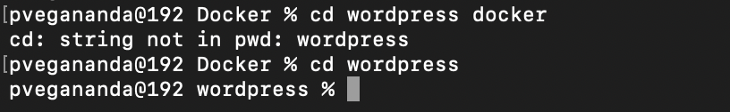
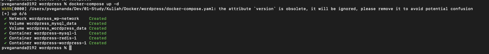
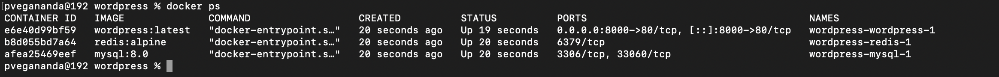

### WordPress Installation

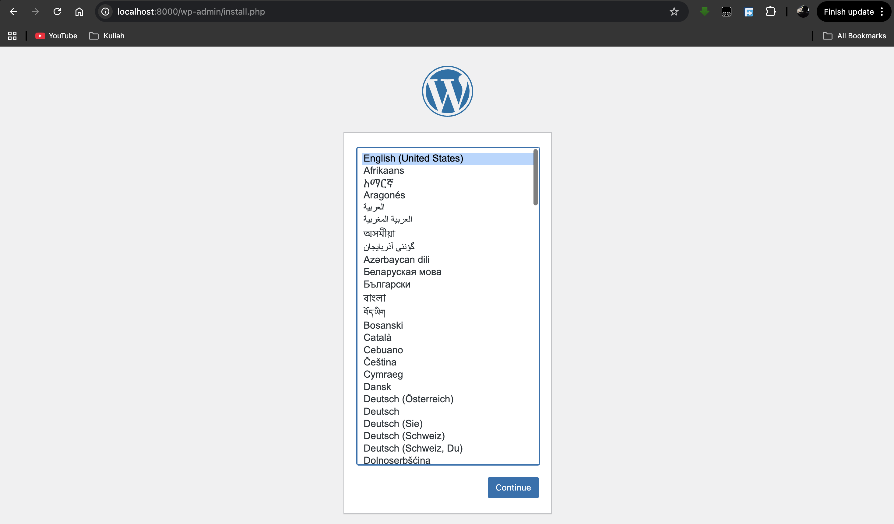
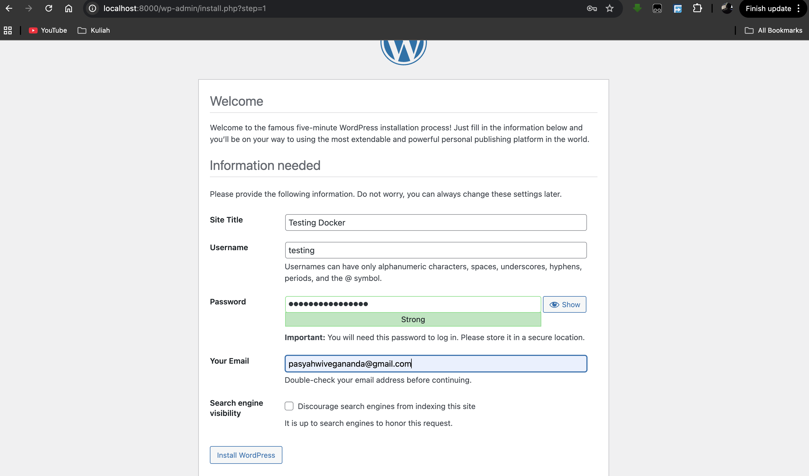
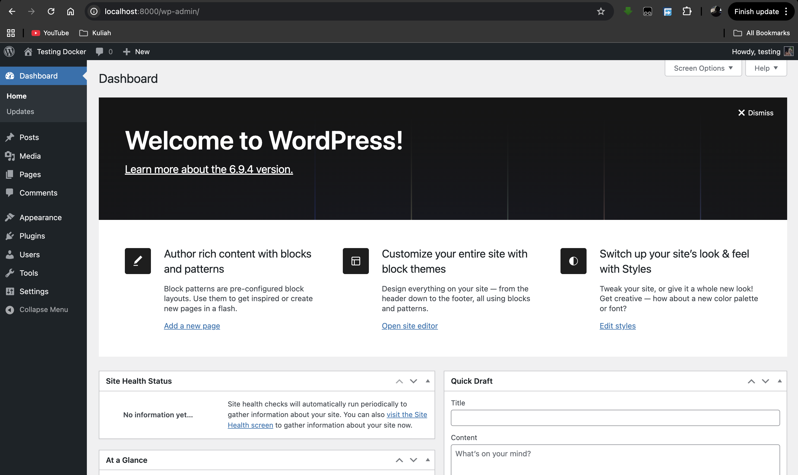

### Redis Integration

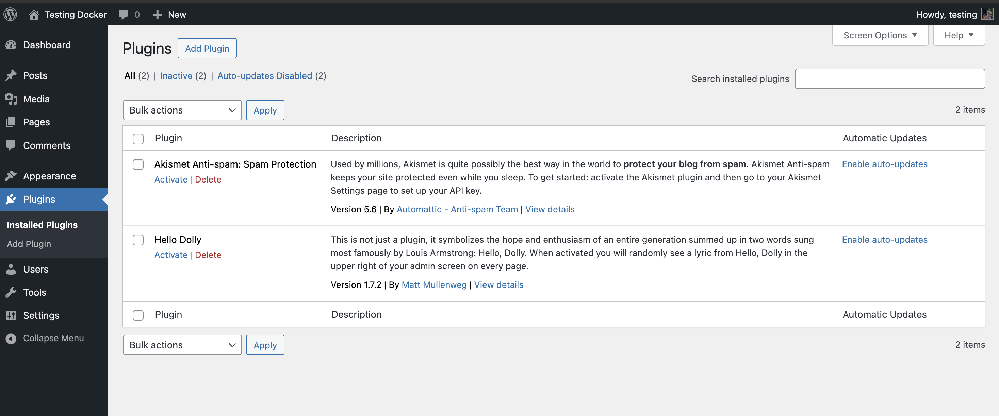
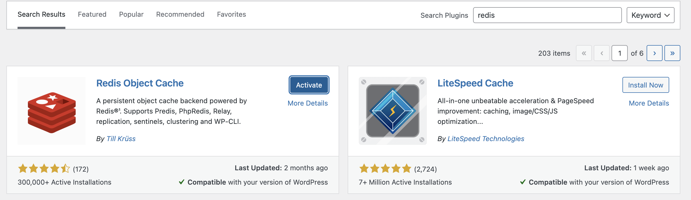
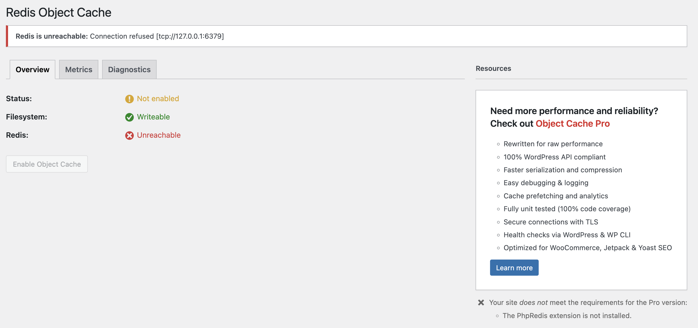
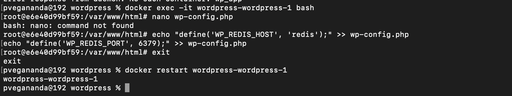
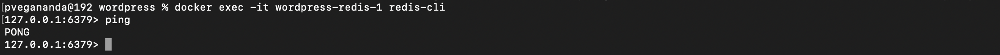
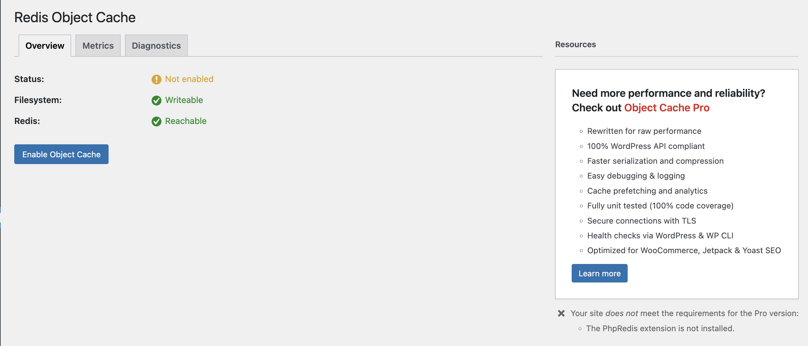

## Project Structure

```text
.
├── docker-compose.yml
├── README.md
└── screenshots/
```

## Author

Created by [Pasyah Vegananda](https://github.com/PVegananda).

For questions or collaboration, feel free to open an issue or connect through
GitHub.
